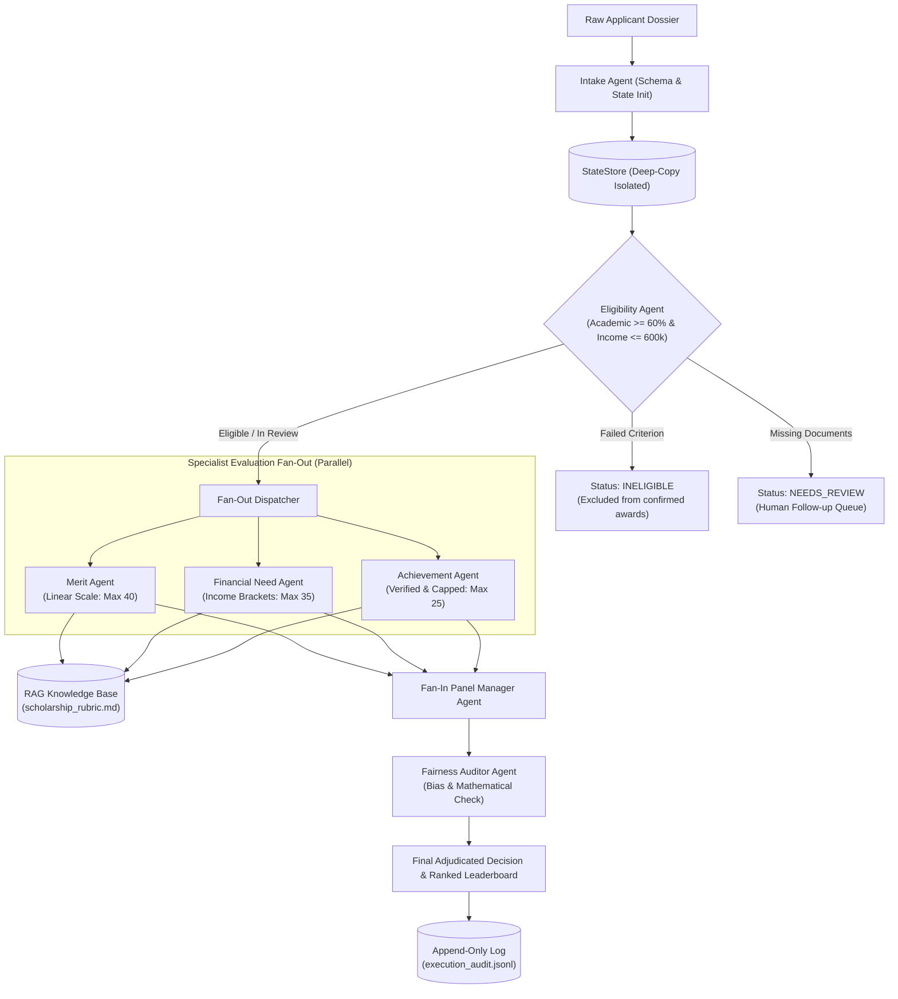

# Automated Grant & Scholarship Application Evaluator
**Course:** CSE476 – Agentic AI and Intelligent Automation (Task 2 / CA2)  
**Project Track:** Q12 – Grant and Scholarship Application Evaluator  
**Framework:** Microsoft Semantic Kernel for Python  
**Architecture:** Fan-Out / Fan-In with Grounded RAG, Shared Memory, and Append-Only Audit Logging  

---

## 1. System Overview & Architecture

The **Automated Grant & Scholarship Application Evaluator** is an enterprise-grade multi-agent system comprising seven specialized Microsoft Semantic Kernel agents designed to review scholarship applicants, evaluate academic excellence, financial need, and extracurricular achievements against a project-created demonstration rubric (synthetic coursework specification for CSE476), and issue policy-grounded recommendations (*High Priority*, *Recommended*, *Consider*, or *Ineligible*).

### Why the Fan-Out / Fan-In Architecture Fits
Scholarship adjudication involves multiple independent evaluation dimensions that can be assessed concurrently once basic eligibility is established:
1. **Intake & Gatekeeping:** The `Intake Agent` parses and validates the applicant dossier. The `Eligibility Agent` verifies hard cutoffs.
2. **Specialist Fan-Out:** The dossier is fanned out in parallel to three specialist agents (`Merit Agent`, `Financial Need Agent`, and `Achievement Agent`), each focusing on their respective scoring criteria.
3. **Adjudication Fan-In:** The `Panel Manager Agent` collects all specialist signals, computes the 100-point composite score, enforces the strict exclusion of disqualified candidates from confirmed ranking, and assigns a formal committee recommendation.
4. **Fairness & Consistency Audit:** The `Fairness Auditor Agent` inspects the rationales for prohibited demographic attributes (gender, religion, category) and verifies mathematical summation consistency.



---

## 2. Agent Roster & Registered Tools

Every agent is developed as an independent module under `agents/` and invokes at least two genuine tools registered via Semantic Kernel plugins (`@kernel_function`):

| Agent Module | Primary Responsibility | Registered Semantic Kernel Tools |
| :--- | :--- | :--- |
| **`IntakeAgent`** (`agents/intake_agent.py`) | Ingests, validates, and initializes candidate dossiers | 1. `parse_applicant_profile`: Validates Pydantic schema.<br>2. `initialize_applicant_state`: Allocates isolated state in `StateStore`. |
| **`EligibilityAgent`** (`agents/eligibility_agent.py`) | Evaluates hard constraints ($\ge 60\%$ academic, $\le \text{₹}600\text{k}$ income) | 1. `verify_eligibility_criteria`: Evaluates hard cutoffs.<br>2. `retrieve_eligibility_rubric_citations`: RAG retrieval of Clauses 1.1–1.3. |
| **`MeritAgent`** (`agents/merit_agent.py`) | Calculates academic merit out of 40 points | 1. `calculate_academic_score`: Linear scaling $(P/100) \times 40$.<br>2. `retrieve_academic_rubric_citation`: RAG retrieval of Clause 2.1. |
| **`FinancialAgent`** (`agents/financial_agent.py`) | Evaluates economic need across progressive brackets | 1. `assess_financial_need`: Maps income to bands (35, 28, 20, 10, 0).<br>2. `retrieve_financial_rubric_citation`: RAG retrieval of Clause 2.2. |
| **`AchievementAgent`** (`agents/achievement_agent.py`) | Validates extracurricular achievements up to 25 points | 1. `evaluate_achievement_portfolio`: Filters unverified, deduplicates claims, caps at 25.<br>2. `retrieve_achievement_rubric_citation`: RAG retrieval of Clause 2.3. |
| **`PanelManagerAgent`** (`agents/panel_manager.py`) | Fuses specialist scores, assigns award tier, enforces exclusions | 1. `adjudicate_scholarship_decision`: Computes total score and tier.<br>2. `retrieve_panel_rubric_citations`: RAG retrieval of Clauses 3.1 & 3.2. |
| **`FairnessAuditorAgent`** (`agents/fairness_auditor.py`) | Audits decisions for ethical bias and calculation accuracy | 1. `audit_demographic_bias`: Scans for prohibited attribute reliance.<br>2. `verify_mathematical_consistency`: Verifies mathematical sum exactness. |

---

## 3. RAG Knowledge Base & Shared Memory

* **RAG Knowledge Base (`rag/scholarship_rubric.md`):** Contains policy clauses governing academic cutoffs, income brackets, tier points, recommendation thresholds, and non-discrimination mandates. (Provenance Notice: Author-created synthetic demonstration rubric designed specifically for the CSE476 Agentic AI specification). The `RubricRetriever` indexes all clauses and attaches citations to justifications.
* **Shared Memory & StateStore (`core/shared_state.py`):**
  * `EvaluationState`: Isolated per applicant dossier. Contains profile, specialist results, total score, recommendation, and execution telemetry.
  * **Deep-Copy Isolation:** When reading or saving state, objects are deep-copied under an `asyncio.Lock` to prevent cross-applicant data leakage during parallel evaluation.
  * **Disk Persistence:** Atomically persisted to `data/state_store.json` using temporary file replacement and explicit error propagation.
  * **Historical Snapshots:** Every state transition captures an immutable milestone snapshot in the applicant's history.
* **Append-Only Audit Logger (`core/audit_logger.py`):** Writes every tool invocation, duration, status, rubric version, and SHA-256 configuration hash into `demonstration_audit.jsonl` (and runtime `execution_audit.jsonl`) using append-mode (`a`). Never overwrites existing logs.

---

## 4. Failure Handling & Non-Discrimination Guarantees

1. **Handling Missing Information:** Missing academic percentage or household income remains `None` (never silently coerced to 0). Incomplete applications are assigned status `NEEDS_REVIEW` and excluded from confirmed ranking until documents are verified.
2. **Disqualification Exclusion Gate:** Applicants with percentage below 60% or income above ₹600,000 are marked `INELIGIBLE`. The `PanelManagerAgent` guarantees they receive `None` as their total score and are blocked from the confirmed award roster.
3. **Demographic Non-Discrimination:** Candidate demographic attributes (`gender`, `religion`, `category`) are tracked solely for fairness monitoring. The `FairnessAuditorAgent` flags any rationale referencing these attributes as biased.

---

## 5. Group Contribution Plan (Team of Three)

| Member | Assigned Components & Ownership |
| :--- | :--- |
| **Member 1** | Academic Evaluation Agent (`MeritAgent`), Financial Need Evaluation Agent (`FinancialAgent`), related unit tests (`test_scoring_config.py`, `test_agents.py`). |
| **Member 2** | Achievement Evaluation Agent (`AchievementAgent`), Eligibility Verification Agent (`EligibilityAgent`), RAG Knowledge Base & Retriever (`rag/`). |
| **Member 3** | Pipeline Coordinator (`orchestration/coordinator.py`), Panel Manager Agent, Fairness Auditor Agent, Shared State Store (`core/`), Streamlit Dashboard (`app.py`), Demo Notebook (`demo.ipynb`), and integration tests. |

---

## 6. Interactive Committee Dashboard (8 Dedicated Pages)

The modern institutional portal in [Project/app.py](file:///c:/Users/Hp/Documents/7th%20SEM%20THINGS/AGENTIC_AI/CA2%20-%20AGENT/Project/app.py) is partitioned into 8 dedicated committee interfaces:
1. **Overview Dashboard:** High-level institutional KPIs (total applicants, eligible count, disqualifications, pending review, average composite score, Plotly score distributions, and recent audit telemetry).
2. **Applicant Management:** Master dossier registry with multi-criteria search, eligibility & tier filtering, score sorting, single-applicant re-evaluation, and one-click dossier inspection.
3. **New Application Form:** Full candidate submission intake form with Pydantic validation, dynamic achievement records, demographic fairness tracking, and one-click **Demo Scenario Presets** (Scenario A, B, and C).
4. **Evaluation Results:** Deep-dive dossier view presenting deconstructed results, score proofs, grounded rubric citations, and one-click **Google Gemini AI Committee Report** generation.
5. **Agent Activity & Trace:** Visualizes the sequential and parallel stages of the Fan-Out / Fan-In coordination pipeline, live inter-agent messaging events, and Semantic Kernel tool execution telemetry.
6. **RAG Rubric Explorer:** Search the official committee rubric knowledge base, retrieve grounded clauses, inspect citations, and query committee policy.
7. **AI Assistant & Advisor:** Interactive Google Gemini interface for qualitative dossier analysis, specialist findings explanations, and grounded rubric Q&A.
8. **Committee Leaderboard:** Official ranked list of confirmed awardees sorted by composite score (#1, #2, #3 medal badges), waitlist pool, segregated disqualification tables, and CSV/JSON data export.

---

## 7. Google Gemini AI Integration & Security Architecture

The system integrates **Google Gemini** via the official `google-genai` SDK and Semantic Kernel AI connectors to provide grounded intelligence and executive reporting while strictly preserving deterministic scoring.

### A. Core Gemini Capabilities
1. **Dossier Profile Analysis:** Synthesizes applicant background, identifies academic/financial strengths, highlights missing transcripts/records, and flags items needing verification.
2. **Multi-Agent Findings Explanation:** Translates raw numeric agent outputs into policy-grounded human explanations for each specialist dimension (Eligibility, Merit, Need, Achievement, Panel, Fairness).
3. **Formal Committee Report Generation:** Produces publication-ready executive committee adjudication reports with structured evaluation breakdowns, rationales, and cited rubric clauses.
4. **Grounded RAG Policy Q&A:** Connects directly to the `RubricRetriever`. Answers questions strictly from retrieved clauses with mandatory citations. If a question is outside the rubric, Gemini explicitly states that the policy does not establish it (zero hallucination guarantee).

### B. Critical Deterministic Scoring Isolation
* **Zero Modification Policy:** Gemini is strictly **read-only**. It CANNOT modify applicant records, academic percentages, household incomes, specialist scores, eligibility verdicts, composite scores, or leaderboard rankings.
* **Resilience:** If the Gemini API is offline, rate-limited, or unconfigured, the entire multi-agent evaluation pipeline and Streamlit dashboard continue working with built-in deterministic fallbacks.

### C. Security & Credential Protection
* **Environment Variable:** Set your key in `Project/.env` as `GEMINI_API_KEY=your_key_here`.
* **Zero Leakage:** `.env` is ignored via `.gitignore`. The application never logs, prints, or exposes the API key in terminal output, audit logs (`execution_audit.jsonl`), or UI widgets (masked as `AIza...****`).
* **Model Configuration:** Configurable via `GEMINI_MODEL=gemini-3.5-flash` with automatic fallback to `gemini-3.5-flash-lite`, `gemini-2.5-pro`, or `gemini-3.8-flash` if your tier lacks access.

---

## 8. Live Academic Demonstration Walkthrough

During your presentation or viva, you can demonstrate the 3 required scenarios directly from the UI:

### Scenario A: Confirmed Eligible High-Priority Nominee
1. Go to **New Application** and click **"🌟 Scenario A: Eligible High-Priority Nominee"**.
2. Notice the pre-filled records: $94.0\%$ academic score, $\text{₹}110,000$ income, and verified International award.
3. Click **"📥 Submit Application Dossier"**.
4. The system executes the full 7-agent pipeline.
5. Navigate to **Evaluation Results** $\rightarrow$ Observe status `ELIGIBLE_CONFIRMED`, score $87.60/100.0$, and recommendation *High Priority*.
6. View **Committee Leaderboard** $\rightarrow$ Observe candidate ranked at the top of Confirmed Awardees.

### Scenario B: Ineligible Candidate (Failed Mandatory Gate)
1. Go to **New Application** and click **"❌ Scenario B: Ineligible Candidate (Failed Gate)"**.
2. Notice the academic percentage is $52.0\%$ (below the mandatory $60.0\%$ threshold).
3. Click **"📥 Submit Application Dossier"**.
4. Observe the immediate gate enforcement: status `INELIGIBLE`, total score `None`.
5. View **Evaluation Results** $\rightarrow$ Notice the red exclusion banner citing Clause 1.1.
6. View **Committee Leaderboard** $\rightarrow$ Candidate is strictly barred from the confirmed awards and placed in the Disqualified Pool.

### Scenario C: Incomplete Application (Mandatory Document Missing)
1. Go to **New Application** and click **"⚠️ Scenario C: Incomplete Application (Needs Review)"**.
2. Notice the household income document is checked as missing (`household_income = None`).
3. Click **"📥 Submit Application Dossier"**.
4. Observe status `NEEDS_REVIEW`. The system refuses to assume zero income or waive the requirement.
5. View **Evaluation Results** $\rightarrow$ Notice the administrative hold banner citing Clause 1.3.
6. Candidate is placed on hold in the Needs Review Pool without receiving a confirmed ranking.

---

## 9. How to Run the Application & Tests

### Step 1: Environment Setup & Gemini API Key (Optional but Recommended)
Copy the example environment file and add your Google Gemini API key:
```powershell
cd "C:\Users\Hp\Documents\7th SEM THINGS\AGENTIC_AI\CA2 - AGENT\Project"
Copy-Item .env.example .env
# Edit .env and set GEMINI_API_KEY=your_actual_key
```

### Step 2: Run Full Automated Test Suite (65 Tests)
Verify that all 65 unit, integration, coordinator gate, and Gemini security tests pass:
```powershell
cd "C:\Users\Hp\Documents\7th SEM THINGS\AGENTIC_AI\CA2 - AGENT\Project"
.\.venv\Scripts\pytest.exe -v
```

### Step 3: Launch Interactive Streamlit Dashboard
```powershell
cd "C:\Users\Hp\Documents\7th SEM THINGS\AGENTIC_AI\CA2 - AGENT\Project"
.\.venv\Scripts\streamlit.exe run app.py
```
* Open **`http://localhost:8501`** in Chrome/Edge.
* Use the sidebar to navigate between the 8 pages, test Gemini connectivity, or run batch evaluation.

### Step 3: Run the Demonstration Notebook
* **In VS Code / IDE:** Open [Project/demo.ipynb](file:///c:/Users/Hp/Documents/7th%20SEM%20THINGS/AGENTIC_AI/CA2%20-%20AGENT/Project/demo.ipynb) and select the `Project/.venv` Python 3.13 kernel.
* **Or via CLI (using system Jupyter):**
  ```powershell
  cd "C:\Users\Hp\Documents\7th SEM THINGS\AGENTIC_AI\CA2 - AGENT\Project"
  jupyter-lab demo.ipynb --runtime-dir="$env:TEMP\jupyter_runtime"
  ```

